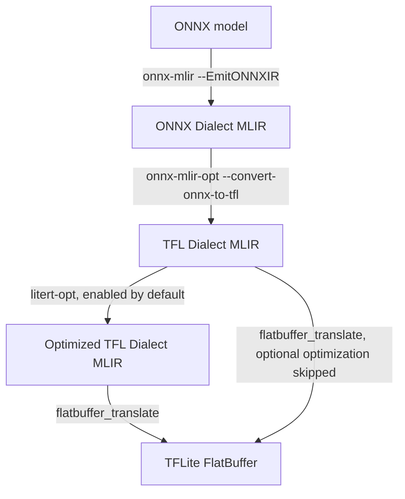

<!-- SPDX-License-Identifier: Apache-2.0 -->
<!-- Modified by FlashUnlimited2019 in 2026. -->

<p align="center">
  
</p>

<p align="center">
  <strong>A native ONNX-to-TFLite compiler powered by MLIR.</strong>
</p>

<p align="center">
  <a href="https://github.com/FlashUnlimited2019/onnx-mlir-to-tflite/releases/latest"></a>
  <a href="LICENSE"></a>
  <a href="https://github.com/FlashUnlimited2019/onnx-mlir-to-tflite/releases/latest"></a>
</p>

<p align="center">
  <a href="#quick-start">Quick Start</a> ·
  <a href="docs/operator-support.md">Operator Support</a> ·
  <a href="docs/compiler-optimizations.md">Compiler Optimizations</a> ·
  <a href="#documentation">Documentation</a>
</p>

ONNX-MLIR to TFLite compiles statically shaped ONNX models directly into
optimized TensorFlow Lite (TFLite) FlatBuffers. Built on
[ONNX-MLIR](https://github.com/onnx/onnx-mlir), it combines MLIR-based
operator legalization, layout-aware lowering, graph optimization, and
verified model export in a single conversion pipeline.

The compiler produces **builtin-only TFLite models**, without constructing
TensorFlow graphs, Keras models, or SavedModel artifacts. Unsupported
configurations fail explicitly rather than falling back to Select TF, Flex,
or custom operators.

## Key Features

- **Native TFLite output:** Direct lowering from ONNX to the TFL Dialect through
  MLIR, followed by FlatBuffer export using standard TFLite operators.
- **Compiler-driven graph optimization:** Applies guarded transformations such
  as projection packing, computation rank reduction, tensor indexing
  simplification, and redundant layout operation elimination. Additional
  TensorFlow/LiteRT optimization is enabled by default and can be disabled
  independently.
- **Layout-aware compilation:** Supports NHWC-oriented lowering in the default
  `legacy` mode and per-value layout optimization in the `experimental` mode,
  which preserves the original ONNX input/output axis order while optimizing
  internal layouts independently.
- **Large model support:** Handles ONNX external weights and buffer-offset
  export for large, self-contained TFLite files, provided the target runtime
  supports buffer offsets.
- **Verified model export:** Verifies intermediate representations, performs
  FlatBuffer round-trip validation, and checks inference signatures before
  publishing the output. Exported models include a `serving_default` signature
  that preserves ONNX input/output names and tensor mappings.

The compiler primarily targets static FP32 inference graphs, with selected
integer and boolean tensor support. See the
[operator support matrix](docs/operator-support.md) for detailed coverage.

## Quick Start

Prebuilt Linux x86_64 runtime packages are available from
**[GitHub Releases](https://github.com/FlashUnlimited2019/onnx-mlir-to-tflite/releases/latest)**.
No source build of LLVM/MLIR, ONNX-MLIR, or TensorFlow/LiteRT is required when
using a compatible package.

### 1. Download and extract

Download the runtime `.tar.gz` archive and its matching `.sha256` file from
the latest release into the same directory. Keep only one runtime archive and
its matching checksum file in that directory when using the commands below:

```bash
sha256sum -c onnx-mlir-to-tflite-runtime-*.tar.gz.sha256

mkdir -p onnx-to-tflite-runtime
tar -xzf onnx-mlir-to-tflite-runtime-*.tar.gz \
  --strip-components=1 \
  -C onnx-to-tflite-runtime

cd onnx-to-tflite-runtime
```

### 2. Convert your model

```bash
./bin/onnx-to-tflite /path/to/model.onnx -o model.tflite
```

The driver handles the compilation, optimization, export, and structural
validation stages automatically.

To disable the additional TensorFlow/LiteRT optimization stage:

```bash
./bin/onnx-to-tflite /path/to/model.onnx -o model.tflite --no-optimize-tfl
```

See the [model conversion guide](docs/convert-model.md) for all command-line
options, layout selection, diagnostics, and large-model conversion.

> [!NOTE]
> The current v0.2.2 manylinux package requires Linux x86_64, glibc 2.28+,
> Python 3.8+, and standard system runtime libraries. Conversion was tested
> on Ubuntu 20.04, 22.04, and 24.04. Check each release's packaged `README.md`
> and `BUILD_INFO.txt` for its exact requirements, including the libstdc++ ABI.
> Use the [source build](#build-from-source) when a compatible package is not
> available for your system.

## Compiler Architecture

The pipeline lowers ONNX through multiple MLIR representations rather than
translating it into a TensorFlow execution graph.



The `--no-optimize-tfl` option belongs to the `onnx-to-tflite` driver. It
selects the bypass path by skipping `litert-opt`, while still using
`flatbuffer_translate` for export; it is not a `flatbuffer_translate` option.

The `onnx-to-tflite` driver orchestrates the full pipeline. ONNX-MLIR provides
ONNX importing, shape inference, and canonicalization. Project-specific MLIR
Dialect Conversion patterns fully legalize ONNX operations into the TFL
Dialect, while the optional TensorFlow/LiteRT stage applies further
canonicalization, fusion, and cleanup before export.

The ONNX-MLIR and TensorFlow toolchains use separate processes and a checked
textual MLIR interface to avoid mixing incompatible LLVM/MLIR C++ ABIs.

See [Architecture](docs/architecture.md) for the complete design.

## Compiler Optimizations

The compiler goes beyond operator mapping by applying graph-level
transformations during ONNX preprocessing, dialect conversion, and TFL
optimization. The goal is to produce simpler computation graphs and reduce
avoidable runtime operations while preserving model semantics.

| Optimization | Purpose |
| --- | --- |
| Projection packing | Combine compatible projection computations. |
| Computation rank reduction | Lower eligible high-rank computations to simpler forms, including supported Conv3D-to-Conv2D reductions. |
| Tensor indexing simplification | Simplify eligible indexing and tensor update patterns. |
| Layout propagation | Optimize internal tensor layouts and eliminate redundant layout conversions. |
| TFL canonicalization and fusion | Apply additional TensorFlow/LiteRT graph optimizations before FlatBuffer export. |

These transformations are applied when their respective shape, type, and
semantic constraints are satisfied. The additional TensorFlow/LiteRT stage
can be disabled with `--no-optimize-tfl` without disabling the
project-specific lowering optimizations.

See [Compiler optimizations](docs/compiler-optimizations.md) for implemented
passes, matching conditions, and transformation details.

## Layout Selection

ONNX image models commonly use NCHW, while TFLite 2D convolution and pooling
operations use NHWC. The compiler provides two layout modes:

| | `legacy` (default) | `experimental` |
| --- | --- | --- |
| Rank-4 FP32 input/output layout | NHWC | Original ONNX axis order |
| Internal layouts | NHWC-oriented convolution and pooling regions | Per-value layout optimization |
| External interface | Callers adapt rank-4 FP32 boundary tensors | Preserves the ONNX input/output axis order |

In `legacy` mode, rank-4 FP32 graph inputs and outputs use NHWC; runtime
transposes are not inserted solely to retain an NCHW external interface.
Adapt those tensors when comparing or integrating converted models.
Rank-1, rank-2, rank-3, and rank-5-or-higher graph boundaries retain their
original ONNX axis order. Scalar boundaries retain rank zero, and integer and
boolean boundary tensors retain their original ONNX axis order in both modes.

In `experimental` mode, all graph inputs and outputs preserve their original
ONNX axis order, with boundary transposes inserted where needed. Internal
layouts are optimized independently.

See [Layout selection](docs/convert-model.md#layout-selection) for usage and
validation guidance, and [Layout policy](docs/layout.md) for detailed
rank-sensitive lowering rules.

## Large Models

For models whose constants would exceed ordinary FlatBuffer metadata limits,
the driver supports TensorFlow's buffer-offset format. Common adjacent
external weight files, such as `model.onnx.data`, are detected automatically
once the configured size threshold is reached.

To request buffer-offset export explicitly:

```bash
./bin/onnx-to-tflite /path/to/model.onnx -o model.tflite --use-buffer-offset
```

The resulting `.tflite` is a single, self-contained file. The consuming
runtime must support TFLite buffer offsets.

## Verification and Testing

The driver validates the generated artifacts before publishing the output:

- MLIR verification after each conversion stage by default.
- Full legalization of ONNX operations, with no unsupported-op fallbacks.
- TFLite `TFL3` file-identifier validation and FlatBuffer round-trip import
  through TensorFlow's parser.
- Validation of inference signatures and tensor mappings, followed by atomic
  publication only after the checks succeed.

### Numerical validation

Structural verification is complemented by an end-to-end similarity utility
for comparing ONNX Runtime and TFLite inference outputs. It accounts for the
selected boundary layout contract and reports cosine similarity, Euclidean
distance, relative Euclidean distance, RMSE, and maximum absolute error.

From the repository root, with the reference runtimes installed and the
corresponding TFLite model available:

```bash
python test/e2e/run_similarity.py \
  --onnx /path/to/model.onnx \
  --tflite /path/to/model.tflite \
  --layout-mode legacy
```

Use the same layout mode as conversion. Models with integer inputs may need
explicit valid input ranges; see the utility's `--help` output.

Numerical validation is a separate test; successful structural conversion
alone does not establish numerical equivalence for every model.

## Scope and Limitations

The compiler focuses on statically shaped inference graphs, primarily with
FP32 activations and selected integer and boolean operations.

Dynamic shapes, general control flow, quantization, sparse tensors, and
arbitrary custom or Flex operators are outside the current scope. Some
complex operations are supported only under specific static constraints or
through ONNX-MLIR importer decomposition.

Consult the [operator support matrix](docs/operator-support.md) for supported
opsets, data types, ranks, attributes, and test coverage, and review
[Known limitations](docs/known-limitations.md) for unsupported configurations.

## Build from Source

The prebuilt release is recommended for model conversion. To develop the
compiler or build for a different environment, run the bootstrap script from
an activated Python environment at the repository root:

```bash
python -m pip install -r requirements.txt onnxruntime tensorflow

PYTHON_BIN="$(command -v python)" \
BUILD_JOBS=8 \
./scripts/bootstrap_and_build.sh
```

The script fetches the pinned LLVM and TensorFlow revisions, builds the
required ONNX-MLIR and TensorFlow/LiteRT tools, and runs an end-to-end smoke
test.

Convert a model using the source-built driver:

```bash
./build/bin/onnx-to-tflite /path/to/model.onnx -o model.tflite
```

Run the ONNX-to-TFL MLIR regression suite:

```bash
llvm-project/build/bin/llvm-lit \
  -sv build/test/mlir/conversion/onnx_to_tfl
```

See the [build guide](docs/build.md) for prerequisites, build configuration,
repository layout, and instructions for reusing existing TensorFlow tools.

## Documentation

Start with the [documentation index](docs/README.md) for this project's guides
and technical references.

| Document | Description |
| --- | --- |
| [Model conversion](docs/convert-model.md) | Driver usage, layout selection, diagnostics, and command-line options |
| [Operator support](docs/operator-support.md) | Supported ONNX operations, opsets, types, ranks, attributes, and test coverage |
| [Compiler optimizations](docs/compiler-optimizations.md) | ONNX preprocessing, layout propagation, lowering-time rank reduction, and TFL structural rewrites |
| [Architecture](docs/architecture.md) | Compiler design, cross-version MLIR boundary, optimization, and export |
| [Layout policy](docs/layout.md) | Rank-sensitive layout contract and convolution lowering rules |
| [Build guide](docs/build.md) | Complete LLVM/MLIR, ONNX-MLIR, and TensorFlow/LiteRT build procedure |
| [Known limitations](docs/known-limitations.md) | Unsupported configurations and implementation constraints |

Inherited ONNX-MLIR documentation is kept separately under
[docs-onnx-mlir/](docs-onnx-mlir/README.md). It describes the upstream compiler,
not the capabilities or build requirements of this project's TFLite pipeline.

## Project Lineage and License

This independent project is built on the upstream
[ONNX-MLIR](https://github.com/onnx/onnx-mlir) compiler infrastructure and adds
the ONNX-to-TFL conversion and TFLite export pipeline.

The upstream base is ONNX-MLIR commit
[`7cea64f8aa2fbc56f859df768211a95dc2c72ad6`](https://github.com/onnx/onnx-mlir/commit/7cea64f8aa2fbc56f859df768211a95dc2c72ad6).
Project-specific compiler, tooling, test, and documentation changes are
maintained independently from that revision.

See [LICENSE](LICENSE) for licensing information. This is not an official ONNX
or ONNX-MLIR release.
