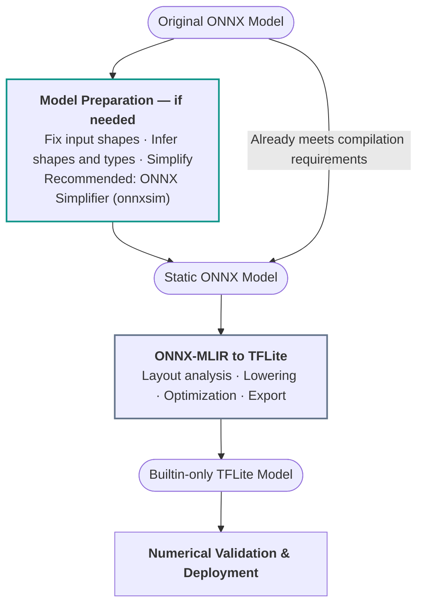

<!-- SPDX-License-Identifier: Apache-2.0 -->

# Convert an ONNX Model

Download a prebuilt compiler from
[GitHub Releases](https://github.com/FlashUnlimited2019/onnx-mlir-to-tflite/releases/latest)
or follow the [build guide](build.md).

## Conversion workflow



> [!IMPORTANT]
> The compiler requires **statically shaped ONNX models** with tensor ranks,
> dimensions, and element types resolvable at compile time. It primarily targets
> FP32 inference graphs, with selected integer and boolean support.
> See [operator support](operator-support.md) and [known limitations](known-limitations.md).

## Prepare the ONNX model

We recommend [ONNX Simplifier (onnxsim)](https://github.com/onnxsim/onnxsim)
to fix input shapes, infer intermediate tensor shapes and types, and simplify
constant computations. This is optional preprocessing, not a compiler dependency.
Skip it if your model already meets the compilation requirements.

```bash
python -m pip install onnxsim
```

For a model with fixed input shapes:

```bash
onnxsim model.onnx model_static.onnx
```

For a model with dynamic input dimensions:

```bash
onnxsim model.onnx model_static.onnx \
  --overwrite-input-shape images:1,3,640,640
```

For multiple inputs:

```bash
onnxsim model.onnx model_static.onnx \
  --overwrite-input-shape input_ids:1,128 attention_mask:1,128
```

Replace the example input names and dimensions with your model's actual inputs.
Use [Netron](https://netron.app/) to inspect them. Specify shapes in the original
ONNX axis order (e.g., NCHW), not the target TFLite layout. Use
`--overwrite-input-shape`, not `--test-input-shape`, to fix the saved model's inputs.

> [!NOTE]
> Fixed input shapes alone do not guarantee a fully static graph; data-dependent
> output sizes may remain dynamic. If intermediate shapes or types remain
> unresolved, try ONNX shape inference or re-export with fixed dimensions.
> onnxsim does not automatically convert unsupported dtypes to FP32. Keep
> external weight files accessible; use its `--save-as-external-data` option
> when needed. Simplification can increase constant storage, so check model
> size and numerical results after preprocessing.

## Basic conversion

From the extracted runtime-package directory:

```bash
./bin/onnx-to-tflite model_static.onnx -o model.tflite
```

For a source build, use `./build/bin/onnx-to-tflite` instead. If preprocessing
is unnecessary, pass the original `model.onnx` directly.

The driver discovers the required tools, performs compilation and structural
validation, and atomically publishes the validated TFLite file. The output
directory is created when necessary.

## Layout selection

| Property | `legacy` (default) | `experimental` |
| --- | --- | --- |
| Rank-4 FP32 inputs and outputs | NHWC permutation | Original ONNX axis order |
| Other boundary tensors | Original ONNX axis order | Original ONNX axis order |
| Internal layout | NHWC-oriented lowering | Per-value layout optimization |
| Example ONNX input `[1, 3, 640, 640]` | `[1, 640, 640, 3]` | `[1, 3, 640, 640]` |

As a practical starting point, use `legacy` for CNN-only models. For Transformer
decoders, `experimental` often produces simpler graphs. If unsure, start with
the default `legacy` mode. Validate accuracy and performance on your target
runtime.

Use the experimental mode to preserve the original ONNX input/output axis order:

```bash
./bin/onnx-to-tflite model_static.onnx -o model.tflite --layout-mode experimental
```

For rank-4 FP32 boundaries in `legacy` mode, adapt application tensors as follows:

```python
input_tflite = input_onnx.transpose(0, 2, 3, 1)
output_onnx = output_tflite.transpose(0, 3, 1, 2)
```

Do not apply these permutations to other boundary tensors or to current
experimental-mode models. Experimental mode may introduce boundary transposes
and should be numerically validated before deployment. Reconvert older
experimental artifacts before relying on the current layout contract.

> [!WARNING]
> Do not infer the layout from tensor shapes alone: a permutation may leave the
> shape unchanged. Always use the layout mode selected during conversion.

See the [layout policy](layout.md) for details.

## Named inference signature

Newly converted models include a `serving_default` signature with ONNX input
and output names, in both layout modes and with or without optional TFL optimization.
The file's signature entries preserve ONNX graph and `main` subgraph ordering
and tensor mappings, including aliased outputs. Some viewers and runtime APIs
may still display names alphabetically; signature calls bind by name, not
display order.

Example using TensorFlow's Python interpreter (in a separate inference environment):

```python
import numpy as np
import tensorflow as tf

interpreter = tf.lite.Interpreter(model_path="model.tflite")
print(interpreter.get_signature_list())
run = interpreter.get_signature_runner("serving_default")
# Example: a single FP32 image input in legacy mode.
outputs = run(images=np.zeros((1, 640, 640, 3), dtype=np.float32))
```

Replace `images`, shape, dtype, and data with your model's actual input(s).
The signature does not change tensor shapes, dtypes, or layouts. Older models
may require reconversion to include the signature. The usual `set_tensor` /
`invoke` / `get_tensor` interface remains available.

## Numerical validation

Structural validation does not guarantee numerical equivalence. Use the
repository's [comparison utility](../test/e2e/run_similarity.py) from the
repository root, in a Python environment compatible with the reference runtimes:

```bash
python -m pip install numpy onnx onnxruntime tensorflow

python test/e2e/run_similarity.py \
  --onnx model_static.onnx --tflite model.tflite --layout-mode legacy
```

Use the same ONNX file and layout mode as the conversion. The utility reports
cosine similarity, Euclidean distance, relative Euclidean distance, RMSE, and
maximum absolute error. For integer inputs, specify valid ranges with
`--integer-input-range NAME:LOW:HIGH` (exclusive upper bound), once per integer
input. Run the script with `--help` for additional options. Also validate with
representative real inputs before deployment; when preprocessing changes the
ONNX graph, check its outputs against the original model as well.

TensorFlow and ONNX Runtime Python packages are needed for this validation,
not for conversion using the prebuilt compiler.

## Large models

The compiler supports ONNX external weights. Automatic buffer-offset export
is enabled when the combined size of the `.onnx` file and any adjacent
`<model>.onnx.data` / `<model>.data` files reaches 1.5 GiB. This also covers
sufficiently large models with inline weights. For other supported external-data
layouts, or to force buffer-offset export, enable it explicitly:

```bash
./bin/onnx-to-tflite model_static.onnx -o model.tflite --use-buffer-offset
```

The output is a single self-contained TFLite file. The target runtime must
support buffer offsets. See [known limitations](known-limitations.md).

## Troubleshooting

| Symptom | What to check |
| --- | --- |
| Dynamic or unresolved shapes/types | [Prepare the ONNX model](#prepare-the-onnx-model). |
| Unsupported operator or dtype | [Operator support](operator-support.md) and [known limitations](known-limitations.md). |
| Shape or numerical mismatch | Check the layout mode, input data, and numerical validation results. |
| Missing weights or large-model export failure | Check external data paths and buffer-offset settings. |
| Required executable not found | Check the package or [build guide](build.md). |

To save MLIR and temporary artifacts from a successful conversion for debugging:

```bash
./bin/onnx-to-tflite model_static.onnx -o model.tflite \
  --dump-onnx-mlir --dump-tfl-mlir --keep-intermediate-files
```

These options save artifacts only after export and verification succeed.
The current driver cleans up temporary files on conversion-stage failure;
capture the error log with `2> conversion.log` when investigating a failed run.

Use `--layout-diagnostics summary` for layout diagnostics and
`--no-optimize-tfl` to isolate issues in the optional TensorFlow/LiteRT
optimization stage. This does not disable the project's lowering optimizations.
When [reporting an issue](https://github.com/FlashUnlimited2019/onnx-mlir-to-tflite/issues),
include the package version or source commit, exact command, error log, and a
shareable reproducer.

## Command-line options

Run `./bin/onnx-to-tflite --help` for the installed version's help text.
Replace placeholders such as `<path>` with actual values. The paired switches
below are alternatives, not arguments to pass together.

### Required arguments

| Option | Description |
| --- | --- |
| `<input.onnx>` | Input `.onnx` model (required). |
| `-o <path>` / `--output <path>` | Output TFLite file (required). |

### Options that require a value

| Option | Description |
| --- | --- |
| `--layout-mode <mode>` | `legacy` (default) or `experimental`. |
| `--layout-diagnostics <level>` | `none` (default), `summary`, or `values`. |
| `--onnx-mlir <path>` | Override the ONNX importer executable. |
| `--onnx-mlir-opt <path>` | Override the ONNX-to-TFL optimizer executable. |
| `--litert-opt <path>` | Override the LiteRT optimizer executable. |
| `--flatbuffer-translate <path>` | Override the FlatBuffer translator executable. |

### Switches that take no value

| Option | Description |
| --- | --- |
| `--optimize-tfl` / `--no-optimize-tfl` | Enable (default) or skip optional TFL optimization. |
| `--verify-each` / `--no-verify-each` | Explicitly request per-pass MLIR verification (default), or leave it to the underlying tools' defaults; see below. |
| `--dump-onnx-mlir` | After successful conversion, save `<name>.onnx.mlir` beside the output. |
| `--dump-tfl-mlir` | After successful conversion, save `<name>.tfl.mlir` beside the output. |
| `--keep-intermediate-files` | After successful conversion, retain `<output>.intermediates`; refuses to overwrite an existing directory. |
| `--use-buffer-offset` / `--no-use-buffer-offset` | Force or disable buffer-offset export, overriding automatic selection. |
| `-h`, `--help` | Show help. |

Currently, `--no-verify-each` omits the explicit verifier flag rather than
forwarding `--verify-each=false`; the underlying tools may still verify passes
by default. It does not disable FlatBuffer or signature validation.

The driver discovers tools from `PATH`, its binary directory, and supported
source/build-tree locations. Explicit executable paths override automatic
discovery. `LITERT_OPT` and `FLATBUFFER_TRANSLATE` environment variables are
also supported.
