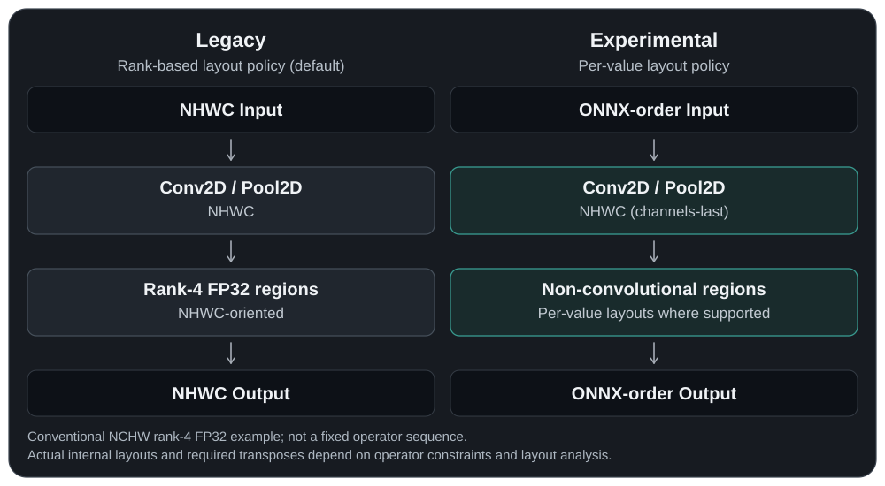

<!-- SPDX-License-Identifier: Apache-2.0 -->

# Layout Policy

This document describes how ONNX-MLIR to TFLite represents, transforms,
and preserves tensor layouts during lowering.

Layout behavior depends on tensor rank, element type, the selected layout
mode, and operator constraints. Equal tensor shapes do not imply equal layouts.

## Layout terminology

- **Logical layout**: the original ONNX axis order and axis meaning.
- **Physical layout**: the actual tensor axis order used by the lowered TFLite graph.
- **Boundary layout**: the input/output layout exposed by the generated TFLite model.

For conventional image tensors, the logical ONNX layout is often `NCHW`,
while TFLite Conv2D and Pool2D operators use `NHWC`.

## Layout modes and boundary contract

| Property | `legacy` (default) | `experimental` |
| --- | --- | --- |
| Public rank-4 FP32 inputs/outputs | `[0, 2, 3, 1]` permutation (NCHW → NHWC) | Original ONNX axis order |
| Other public tensors | Original ONNX axis order | Original ONNX axis order |
| Internal layout policy | Rank-based, NHWC-oriented lowering | Per-value layout optimization |
| Conv2D / Pool2D regions | NHWC | NHWC where required by the kernels |
| Non-convolutional regions | NHWC-oriented for rank-4 FP32 | Inferred per value where supported |
| Starting point | CNN-only models or an unfamiliar model | Transformer decoders or preserving the ONNX interface |

These are practical starting points, not performance guarantees. Validate
accuracy and latency on the target runtime when choosing a mode.



*Figure 1. Schematic comparison for conventional NCHW rank-4 FP32 activations
and boundaries. Actual internal layouts and required Transpose operations
depend on operator constraints and layout analysis; the diagram is not a
fixed operator sequence.*

### Legacy mode

In the default `legacy` mode:

- exactly rank-4 FP32 graph inputs and outputs use the `[0, 2, 3, 1]`
  permutation at the public interface;
- all other public tensors, including scalars, other ranks, and integer or
  boolean tensors, keep their original ONNX axis order;
- internal Conv2D and Pool2D regions stay NHWC-oriented.

For conventional NCHW image tensors, callers therefore pass NHWC inputs and
receive NHWC outputs. The permutation also applies to rank-4 FP32 boundaries
with non-image semantics: the compiler does not infer whether their axes
actually mean N, C, H, and W. No runtime boundary `Transpose` is inserted
merely to preserve the original ONNX rank-4 FP32 interface.

### Experimental mode

In `experimental` mode:

- all graph inputs and outputs keep their original ONNX axis order,
  including rank-4 tensors;
- internal tensors may use different physical layouts;
- boundary layout conversions are inserted only where needed to connect the
  public ONNX-order interface to internal layouts.

Per-value layouts are used only where the relevant producers and consumers
support them. Other regions retain the established lowering, with layout
conversions where needed; this does not change the public boundary contract.
Layout-only changes involving singleton axes may use Reshape instead of
Transpose.

> [!NOTE]
> Earlier experimental artifacts may expose mixed rank-4 layouts.
> Reconvert older models before relying on the current layout contract.

## Axis mapping

For rank-4 FP32 tensors in legacy lowering, logical ONNX axes map to
physical TFL axes as follows. Image-axis names are illustrative.

| Logical ONNX axis | Physical TFL axis |
| --- | --- |
| `0` (`N`) | `0` (`N`) |
| `1` (`C`) | `3` (`C`) |
| `2` (`H`) | `1` (`H`) |
| `3` (`W`) | `2` (`W`) |

The corresponding **transpose permutations** are:

```python
NCHW_to_NHWC = [0, 2, 3, 1]
NHWC_to_NCHW = [0, 3, 1, 2]
```

A transpose permutation lists source axes in destination order; it is not
the logical-to-physical axis-index mapping in the table.

The operation-level NHWC mappings below describe legacy lowering and
channels-last internal regions. They are **not** a requirement on
experimental graph inputs or outputs.

## Broadcasting and non-activation tensors

Not every tensor associated with a rank-4 computation is itself a rank-4
activation. Lower-rank operands must broadcast against the logical ONNX
suffix axes, even when the physical axis order differs.

For FP32 elementwise operations producing a legacy rank-4 result:

| Logical ONNX operand | NHWC-compatible broadcast form |
| --- | --- |
| `[C, 1, 1]` | Reshape to `[1, 1, C]` |
| `[W]` | Reshape to `[1, W, 1]` |
| `[H, W]` | Reshape to `[H, W, 1]` |
| `[C, H, W]` | Transpose to `[H, W, C]`, or Reshape if only singleton axes move |

For example, BatchNorm-style `[C, 1, 1]` channel parameters only require a
reshape; their values are not reordered.

In experimental rank-4 FP32 arithmetic and Min/Max lowering, the compiler
also accounts for independently permuted lower-rank operands and result
layouts. It aligns logical suffix axes, reorders non-singleton axes only
when necessary, and inserts the required singleton dimensions. This preserves
broadcasting without expanding the operand data or introducing rank-5
intermediates for this adaptation.

## Convolution layouts

### Conv2D filters

ONNX Conv2D weights use `[M, C/group, kH, kW]` (OIHW), while TFL `conv_2d`
expects `[M, kH, kW, C/group]` (OHWI). The conversion uses permutation
`[0, 2, 3, 1]`; bias remains a rank-1 `[M]` tensor.

Constant filters are reordered at compile time, either during constant
lowering or by folding filter transformations in the optional TFL optimizer.
Runtime or computed filters are converted from their tracked layout to OHWI
before kernel selection. Disabling TFL optimization can leave explicit filter
transformations in the graph.

Equal numeric shapes do not make the permutation optional: OIHW `[4, 3, 3, 3]`
and OHWI `[4, 3, 3, 3]` still represent different axis orders.

Non-depthwise grouped Conv2D uses one builtin `conv_2d`, with groups inferred
from the input and filter channel dimensions. It does not split into one
operator per group; the target backend must support implicit Conv2D groups.

### Depthwise Conv2D

For depthwise convolution, filters normally use TFL's
`[1, kH, kW, M]` layout, where `M = input_channels * depth_multiplier`.
The optional TensorFlow/LiteRT optimizer folds constant filter transformations.

As a runtime compatibility measure, FP32 depthwise convolutions with more
than 4,832 output channels instead use one builtin `conv_2d` with OHWI
filters and implicit grouping. This avoids a limitation in affected native
FP32 depthwise kernels; it is not a TFLite format limit. The rule also applies
to Conv1D and removable-axis Conv3D lowered through Conv2D, in both modes.
It adds no per-group splits or concatenation and requires grouped-Conv2D
support in the target backend.

### Conv1D lowering

ONNX Conv1D starts in logical `NCL` order. The local lowering:

1. transposes `NCL` to `NLC`;
2. reshapes to `[N, L, 1, C]`;
3. evaluates the convolution through Conv2D;
4. removes the singleton spatial axis and transposes back to `NCL`.

ONNX filters `[M, C/group, k]` become `[M, k, 1, C/group]`, or the
corresponding TFL depthwise layout. Subsequent graph optimization may remove
redundant reshapes or transposes around this sequence.

### Conv3D reduction and fallback

A spatial axis can be removed from Conv3D when its kernel extent and stride
are both one, it has no effective padding, and its input and output extents
are equal. The current reduction paths accept supported `NOTSET`, `VALID`,
and `SAME_UPPER` configurations; `SAME_LOWER` uses the direct Conv3D fallback.

The removable-axis lowering permutes `NCDHW` so the preserved spatial axis
is adjacent to batch, folds that axis into batch, runs Conv2D over the
remaining two spatial axes, and restores logical output order.

With the required stride and padding conditions, this includes kernels
`(1, h, w)`, `(d, 1, 1)`, `(d, 1, w)`, and `(d, h, 1)`. The `(d, 1, 1)`
case is effectively Conv1D, represented by Conv2D with a singleton kernel
dimension because TFLite has no builtin Conv1D.

Two additional reductions apply to group-one convolutions with unit depth
dilation and no depth padding:

- **Full-depth kernel:** the depth kernel covers the entire input depth and
  produces one output depth position; depth and input channels are merged.
- **Nonoverlapping depth windows:** depth stride equals depth kernel size,
  the kernel size exceeds one, and the windows exactly tile the input depth;
  output depth is folded into batch and kernel depth into channels.

Compatible surrounding layout operations can also be eliminated. These
reductions do not imply a general rank-4 activation limit or change rank-5
public interfaces. See [Convolution rank reduction](compiler-optimizations.md#convolution-rank-reduction)
for matching conditions and layout-chain optimizations.

If no supported reduction applies, direct Conv3D uses:

- input: `NCDHW` → `NDHWC`;
- filters: `[M, C/group, kD, kH, kW]` → `[kD, kH, kW, C/group, M]`;
- operation: `tfl.conv_3d`;
- output: `NDHWC` → `NCDHW`.

Non-reducible grouped and depthwise Conv3D split input, filters, and bias
by group, emit one ordinary Conv3D per group, and concatenate the outputs.
This differs from the implicit grouping used by Conv2D.

## Padding semantics

ONNX explicit padding and TFLite `SAME` padding can select different
alignments, especially with strides greater than one.

### Convolution

- `SAME_UPPER` maps to TFL `SAME`; `VALID` maps directly.
- Nonzero explicit `auto_pad=NOTSET` padding is materialized in the physical
  input layout, followed by convolution with `VALID`. For Conv2D, this is an
  NHWC `tfl.pad` followed by `tfl.conv_2d` or `tfl.depthwise_conv_2d`.
- Conv1D/2D do not support `SAME_LOWER`. Direct Conv3D supports it by computing
  static lower-biased padding, materializing the padding, and using `VALID`.

Later optimization may absorb explicit padding when equivalence can be proved.

### Pooling and Pad

The native rank-4, single-output MaxPool path maps `SAME_UPPER` to `SAME`
and `VALID` directly.
Nonzero explicit padding uses NHWC `tfl.padv2` followed by pooling with `VALID`.
Its fill value is the lowest finite `f32` value, not negative infinity;
models relying on `-inf` or NaN behavior require separate numerical validation.
Other pooling forms have their own attribute and rank constraints; see the
[operator support matrix](operator-support.md).

Standalone Pad supports static rank-1 through rank-5 FP32 tensors with
supported nonnegative padding:

- rank-4 logical `[N, C, H, W]` begin/end vectors map to an NHWC `[4, 2]`
  padding matrix inside the Pad lowering;
- other ranks retain their logical axis order;
- constant padding uses `tfl.padv2`;
- reflect padding uses `tfl.mirror_pad`;
- edge padding uses boundary Slice, Tile, and Concat operations.

Experimental mode bridges this lowering to the selected surrounding layouts
as needed; it does not change the public ONNX-order interface.

## Layout-sensitive operations

Axis-sensitive lowering preserves logical ONNX semantics while adapting
operations to their physical layouts. Representative cases include:

| Operation | Behavior |
| --- | --- |
| `Concat` / `Split` | Remap the logical concatenation or split axis to the physical axis. |
| `Slice` | Remap axes and slicing parameters; negative steps may use ReverseV2. |
| `Transpose` | Translate logical permutations to physical order; eliminate an operation when the layout encoding already represents its effect. |
| `Resize` | Native 2D resize paths use NHWC; other supported configurations use logical-axis decompositions. |
| `Reshape` / `Squeeze` / `Unsqueeze` | Preserve logical element order, using layout conversions when required; compatible singleton-only changes remain reshapes. |
| `Flatten` | Restore logical element order before the rank-2 reshape when necessary. |
| `Softmax` | Map the logical axis, move it to the last physical dimension if needed, then restore the physical order. |
| `MatMul` | Preserve logical batch and matrix axes; use layout conversions or absorb compatible permutations into matrix operations. |
| `ReduceMean` / `ReduceSum` / `ReduceMax` | Use mapped reduction axes and result layouts where supported; legacy paths may restore logical order around the reduction. |

The final graph can contain fewer layout operations than these local
lowering sequences after redundant operations are removed. This is an
optimization opportunity, not a guarantee that every Transpose is removable.

## Diagnostics and validation

To select experimental mode and print a layout analysis summary:

```bash
./bin/onnx-to-tflite model.onnx -o model.tflite \
  --layout-mode experimental --layout-diagnostics summary
```

Diagnostic levels are `none` (default), `summary`, and `values`; `values`
includes per-value information. Diagnostics are read-only and can be used
with either mode. They do not change the selected layout policy or describe
every optimization in the final graph. For a source build, use
`./build/bin/onnx-to-tflite` instead.

For end-to-end numerical checking, use the comparison utility described in
[Convert an ONNX Model](convert-model.md#numerical-validation). Always use
the same ONNX model and layout mode as the conversion.

> [!WARNING]
> Do not infer layout from tensor shapes alone. A permutation may leave the
> numeric shape unchanged while still changing the semantic axis order.

## Further reading

- [Convert an ONNX Model](convert-model.md)
- [Compiler optimizations](compiler-optimizations.md)
- [Operator support](operator-support.md)
- [Known limitations](known-limitations.md)
